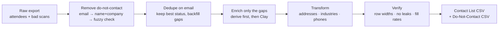

# Event Contact List: from messy badge scans to a CRM-ready list

> **Outcome:** a raw conference export becomes one clean, deduped, enriched CSV in a fixed schema your CRM import can trust, with a do-not-contact record showing who was removed and why.

A [Claude skill](https://docs.claude.com/en/docs/agents-and-tools/agent-skills/overview) plus Python helpers that I built for the least glamorous and most error-prone part of event marketing: the list you get *after* the event.

---

## The problem

Event exports are messy. Several tabs, the same people registered twice, personal emails on badge scans and work emails on the attendee list, switchboard numbers repeated across dozens of rows, cities written as postcodes or "Greater Reading Area," and a "bad scans" list of people who must **not** be contacted. Get it wrong and you either email someone who opted out, or you quietly delete good prospects.

## How it works



1. **Remove the do-not-contact list first, carefully.** Match on email, then on name plus company (accent- and case-insensitive), then run a fuzzy sweep and check the near-misses by eye. **It never matches on phone alone**, because shared switchboard numbers would quietly remove the wrong people.
2. **Dedupe on email,** keeping the best status (`Attended` > `No-show` > `Cancelled`) and filling any blanks from the duplicate.
3. **Fill in what's already there before paying for enrichment.** Derive domains from websites and work emails before using any Clay credits. Dedupe companies before the address lookup, which roughly halves the cost.
4. **Transform deterministically.** `scripts/transform.py` parses HQ addresses in many formats, normalizes LinkedIn locations to real cities, maps industries to a CRM picklist, turns `51-200` into `200`, and strips post-nominals from surnames.
5. **Verify before handing over:** consistent row widths, unique emails, **zero do-not-contact leaks**, and no suspicious city values.

## Example

Input records ([`examples/records.json`](examples/records.json), made up) → output:

```
First Name,Last name,Company name,Company domain,Company City,Company Country,Contact City,Contact Country
Ava,Calder,Northwind Logistics,northwind-logistics.example,San Francisco,United States,Oakland,United States
Ben,Frost,Bluepeak Software,bluepeak.example,Dublin,Ireland,Dublin,Ireland
Chloe,Marsh,Lumen Analytics,lumen.example,,,London,United Kingdom
José,Núñez,Saffron Retail,saffron.example,Madrid,Spain,Madrid,Spain
```

Notice: `Calder ACCA` → `Calder`, `Greater Dublin Area` → `Dublin`, and Chloe's company address of `Global` gives a **blank** city rather than a guess.

## Rules that came from real mistakes

- **Never accept a domain guessed from a company name alone.** Enrichment tools return confident wrong answers for generic names. If a domain can't be verified, it's left blank and listed for review.
- **Fill the do-not-contact sheet from the full list first, not from enrichment.** Almost everyone scanned is also on the attendee list, which is cheaper and more accurate.
- **Never invent a status.** Being scanned at the booth doesn't count as attending.
- **Percent-encode non-ASCII LinkedIn URLs,** or one name with an accent fails the whole bulk run.
- **Save as UTF-8 with a BOM** so Excel keeps accents like `Côte d'Ivoire` and `José` intact.

## What's in the repo

| Path | What it is |
|---|---|
| `SKILL.md` | The full workflow Claude follows, step by step |
| `scripts/transform.py` | Deterministic cleaning (addresses, locations, phones, headcount, names) and CSV writer with fill-rate report |
| `scripts/industry_map.py` | Maps LinkedIn industries to the CRM picklist (extend it for your own CRM) |
| `examples/` | Made-up input records and the resulting CSV |

## Use it

```bash
python3 scripts/transform.py examples/records.json "out.csv"          # contact list
python3 scripts/transform.py scans.json "bad-scans.csv" --scans       # do-not-contact sheet
```

For the enrichment step, install the [Clay](https://clay.com) CLI and create the four routines listed in `SKILL.md` in your own workspace. Everything else is plain Python 3.

---

*Part of my [event ops toolkit](https://github.com/parker-lauren): [run the program](https://github.com/parker-lauren/event-program-os) → [vet the event](https://github.com/parker-lauren/event-vetting) → [enrich the leads](https://github.com/parker-lauren/webinar-lead-enrichment) → **clean the list** → [debrief honestly](https://github.com/parker-lauren/event-debrief). All names, companies and data here are made up.*
